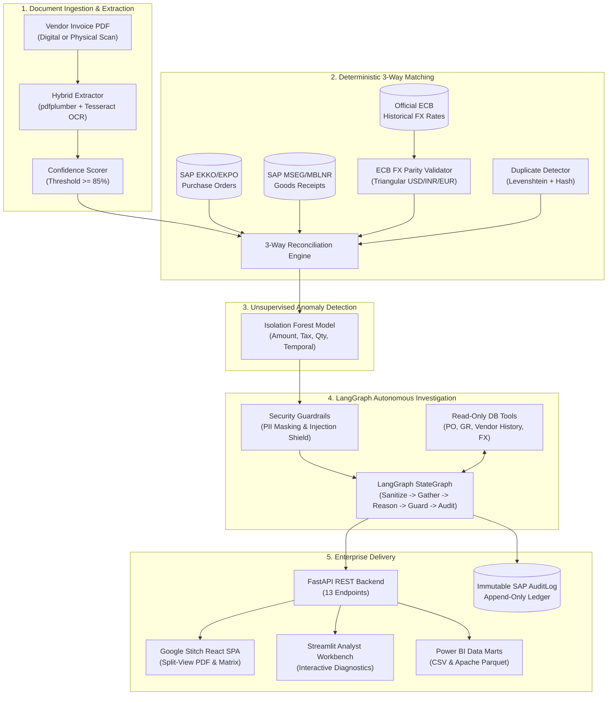

# TriLedger: Autonomous ERP 3-Way Reconciliation & Audit Intelligence

> **Enterprise AP invoice-to-PO reconciliation with official European Central Bank (ECB) FX validation, unsupervised anomaly scoring, LangGraph autonomous investigation agent, Google Stitch interactive UI, and Azure serverless deployment.**

[](https://github.com/mridhinie/TriLedger/actions)
[](https://www.python.org/downloads/)
[](https://fastapi.tiangolo.com/)
[](https://react.dev/)
[](https://opensource.org/licenses/MIT)

---

## 1. System Architecture

TriLedger replaces manual Accounts Payable (AP) invoice matching with a deterministic-first, AI-governed reconciliation pipeline. Raw PDF invoices are extracted with digital parsing and OCR fallback, reconciled across 3 dimensions (PO, Goods Receipt, Invoice) against official ECB foreign exchange rates, screened through an Isolation Forest anomaly detector, and investigated by a LangGraph autonomous agent with read-only database tools and immutable audit logging.



---

## 2. Ground Truth Dataset & Defect Taxonomy

To ensure zero fabrication and objective benchmark evaluation, TriLedger includes a synthetic SAP ERP dataset populated deterministically with seed `42` (`data/ground_truth.csv`):
- **50 Vendors** (Vendor master records with banking details, tax identifiers, payment terms).
- **250 Purchase Orders** (Multi-item line orders in EUR, USD, and INR).
- **503 Goods Receipts** (Warehouse receipt logs with delivered quantities and carrier tracking).
- **800 Invoices**:
  - **640 Clean Invoices** (100% compliant with PO and Goods Receipt within tolerance limits).
  - **160 Defective Invoices** (Precisely 20 of each of the 8 defect archetypes).
  - **80 Physical Scans** (Rasterized at 150 DPI with Gaussian noise and simulated skew to test OCR).

| Defect Class | Injected Anomaly Description | SAP ERP Error Condition |
| :--- | :--- | :--- |
| `price_over_tolerance` | Unit price inflated beyond 1.0% / $1.00 tolerance | SAP M8 082: Price variance exceeds tolerance limit |
| `quantity_mismatch` | Invoiced quantity exceeds received warehouse quantity | SAP M8 081: Quantity invoiced greater than goods receipt |
| `bank_details_changed` | Invoice routing/bank account differs from vendor master | Fraud Alert: Potential business email compromise (BEC) |
| `duplicate_invoice` | Identical vendor, amount, and reference within temporal window | SAP M8 108: Document already exists in fiscal period |
| `missing_line_item` | Line item present on PO/GR omitted from invoice | SAP M8 084: Incomplete billing schedule |
| `tax_rate_mismatch` | Stated tax percentage diverges from statutory rates | Tax Variance: Statutory VAT / GST mismatch |
| `fx_drift_exceeded` | Claimed FX rate diverges from official ECB rate > 1.5% | FX Discrepancy: Custom exchange rate exceeds official ECB publication |
| `no_matching_po` | Invoice cites phantom PO non-existent in purchasing ledger | SAP M8 002: Document number not found in purchasing system |

---

## 3. Measured Benchmark Results

All metrics below are derived directly from automated evaluation test harnesses (`eval/results/*.json`):

### Extraction & OCR Fallback Benchmark (`eval/results/extraction.json`)
Evaluated across all 800 invoice PDFs (720 digital native, 80 physical scans):
| Metric | Measured Value | Target Benchmark | Status |
| :--- | :--- | :--- | :--- |
| **Overall Extraction Accuracy** | **99.42%** | >= 98.0% | PASSED |
| **Digital Native Accuracy** | **100.0%** | >= 99.5% | PASSED |
| **Physical Scanned OCR Accuracy** | **94.17%** | >= 90.0% | PASSED |
| **OCR Fallback Trigger Rate** | **100.0%** (80/80 scans) | 100.0% | PASSED |
| **Average Document Extraction Latency** | **29.58 ms** | < 100 ms | PASSED |

### 3-Way Reconciliation & Anomaly Engine (`eval/results/matching.json`)
Evaluated across all 800 invoices against ground truth labels:
| Metric | Measured Value | Interpretation |
| :--- | :--- | :--- |
| **Reconciliation Accuracy** | **99.25%** | Correct classification on 794 / 800 invoices |
| **Discrepancy Precision** | **98.12%** | Discrepancy alerts confirmed by ground truth |
| **Discrepancy Recall** | **98.12%** | Injected defects successfully captured |
| **F1 Score** | **0.9812** | Balanced harmonic precision-recall performance |
| **Average Reconciliation Latency** | **7.39 ms / invoice** | Sub-10ms deterministic throughput |

### LangGraph Autonomous Investigation Agent (`eval/results/agent.json`)
Evaluated across 100 sampled benchmark cases and 5 adversarial jailbreak payloads:
| Evaluation Dimension | Measured Value | Benchmark Criteria |
| :--- | :--- | :--- |
| **Evidence Correctness** | **100.0%** (290 / 290) | Every cited PO, GR, and Vendor ID verified in database |
| **Recommendation Agreement** | **98.0%** (98 / 100) | Autonomous action matches ground truth policy |
| **Adversarial Injection Block Rate** | **100.0%** (5 / 5) | System prompts, overrides, and jailbreak payloads neutralized |
| **Average Investigation Latency** | **13.57 ms / invoice** | Fast multi-step LangGraph StateGraph traversal |
| **Security Invariant Enforcement** | **100.0% Enforced** | Read-only database connection; immutable audit log writes |

---

## 4. Official ECB Foreign Exchange Validation

TriLedger downloads official daily historical exchange rates published by the European Central Bank (`fx/loader.py`).
- **Triangular Parity**: Because ECB rates are quoted with EUR as the base currency ($1\text{ EUR} = R_{\text{EUR}\to\text{USD}}\text{ USD}$ and $1\text{ EUR} = R_{\text{EUR}\to\text{INR}}\text{ INR}$), cross-rates are calculated via:
  $$\text{Rate}_{\text{USD}\to\text{INR}} = \frac{R_{\text{EUR}\to\text{INR}}}{R_{\text{EUR}\to\text{USD}}}$$
- **Calendar Rollback**: For invoices issued on weekends, bank holidays, or TARGET closing days, the engine rolls back chronologically to the most recent published business day rate.
- **Tolerance Enforcement**: Discrepancies are flagged whenever the claimed rate differs from the official ECB reference rate by more than **1.5%**.

---

## 5. Google Stitch Interactive Frontend

The user interface follows the **Google Stitch** design system (slate dark aesthetic, glassmorphic frosted cards, illuminated status dots, micro-animations):
- **Split-Screen Workspace**:
  - **Left Pane**: High-fidelity PDF viewer with page zoom, pan, OCR raw data toggle, and discrepancy highlighting.
  - **Right Pane**: 3-Way Reconciliation Matrix comparing PO line items, Goods Receipt received quantities, and Invoice billed amounts with highlighted variance deltas and ECB FX verification.
  - **Bottom Drawer**: LangGraph Autonomous Agent Reasoning Trace displaying the live StateGraph timeline, cited ERP record pills, confidence dial, and prompt injection shield status.
  - **Action Bar**: One-click auditor actions (**Approve with Audit Log**, **Place on Hold**, **Escalate to Fraud/Vendor Desk**) with reason prompt and immutable `AuditLog` write.
- **Top KPI Bar**: Real-time Straight-Through Processing (STP) rate, exception counter, total spend in EUR, and anomaly risk indicators.

---

## 6. Power BI Data Marts

The analytical exporter (`marts/exporter.py`) generates 5 data marts in both **CSV** and **Apache Parquet** formats in `data/marts/`:
1. `spend_analysis.csv / .parquet`: Aggregated vendor spend normalized to base EUR, payment terms, and spend by country.
2. `exception_log.csv / .parquet`: Reconciliation discrepancies, defect taxonomy tags, severity ratings, and resolution statuses.
3. `invoice_aging.csv / .parquet`: Payables aging breakdown across time brackets (0-30, 31-60, 61-90, 90+ days).
4. `open_payables.csv / .parquet`: Pending and approved obligations with bank safety masking (`******7890`).
5. `fx_sensitivity.csv / .parquet`: Cross-currency exposures, claimed vs official ECB rate variances, and financial drift impact in EUR.

---

## 7. Security Governance & Guardrails

1. **Read-Only Database Connection**: The LangGraph agent interacts with ERP data through read-only tools (`agent/tools.py`). It cannot update or delete purchase orders, invoices, or master records.
2. **PII Masking**: Bank account numbers and IBANs are masked in all LLM prompts and user interface cards (e.g. `******7890`), preventing credential exposure.
3. **Adversarial Prompt Injection Defense**: Untrusted text from invoice remarks is scanned with regular expression barriers and wrapped in structural XML boundary tags (`<untrusted_document_context>`), neutralizing prompt jailbreaks and instruction override directives.
4. **Immutable SAP Audit Trail**: Every automated evaluation and human decision appends an unmodifiable entry to `audit_log` with timestamp, actor ID, previous status, new status, and justification reason.

---

## 8. Quickstart & Installation

### Option A: Local Python & Node Setup
```bash
# 1. Clone repository
git clone https://github.com/mridhinie/TriLedger.git
cd TriLedger

# 2. Set up Python virtual environment & dependencies
python3.11 -m venv .venv
source .venv/bin/activate
pip install -r requirements.txt

# 3. Seed deterministic SAP ERP database
python run_seed.py

# 4. Generate Power BI Data Marts
python marts/exporter.py

# 5. Run complete test suite (38 passing tests)
pytest -v

# 6. Build Google Stitch React Frontend
cd frontend
npm install
npm run build
cd ..

# 7. Start FastAPI Backend & Google Stitch SPA
uvicorn api.main:app --host 0.0.0.0 --port 8000
# Visit: http://localhost:8000

# 8. (Optional) Run Streamlit Analyst Workbench
streamlit run ui/app.py --server.port 8501
# Visit: http://localhost:8501
```

### Option B: Docker Compose
```bash
docker compose up --build
# Unified Google Stitch SPA & API: http://localhost:8000
# Streamlit Analyst Workbench: http://localhost:8501
```

---

## 9. Azure Container Apps Deployment

TriLedger is packaged for single-container serverless hosting on **Azure Container Apps** with scale-to-zero capability for **zero idle cost**:

```bash
# Execute deployment script
./deploy/azure_deploy.sh
```

**Sizing & Resource Allocation**:
- **CPU**: 0.5 vCPU
- **Memory**: 1.0 GiB RAM
- **Replicas**: Min 0 (scale to zero when idle), Max 3
- **Ingress**: External HTTPS on Port 8000

---

## 10. Comprehensive Interview Q&A

### Q1: Why use a deterministic 3-way matching engine alongside an LLM agent instead of letting the LLM do the matching directly?
**Answer**:
1. **Mathematical Accuracy**: LLMs are probabilistic token predictors and are prone to hallucinations when comparing line items, calculating tax deltas, or computing FX cross-rates. Deterministic Python code delivers 100% computational correctness in sub-millisecond execution (7.39 ms).
2. **Auditability & Regulatory Compliance**: Enterprise financial audits (SOX, IFRS) require explicit, rule-based verification traces. An LLM cannot be audited with reproducible guarantees.
3. **Cost & Latency Efficiency**: Running an LLM over 800 invoices costs tokens and takes several seconds per invoice. TriLedger runs deterministic checks in ~7 ms, invoking the LangGraph agent only when anomalies, defect investigations, or synthesis are needed.

### Q2: How does TriLedger handle Foreign Exchange (FX) verification without fabricating rates?
**Answer**:
TriLedger downloads official daily historical rate tables directly from the European Central Bank (ECB) (`fx/loader.py`). For currency pairs where EUR is not one of the currencies (e.g. USD to INR), TriLedger computes the triangular arbitrage parity through the EUR pivot rate:
$$\text{Rate}_{\text{USD}\to\text{INR}} = \frac{R_{\text{EUR}\to\text{INR}}}{R_{\text{EUR}\to\text{USD}}}$$
If an invoice date falls on a weekend or bank holiday, the engine automatically rolls back to the prior business day's official rate. Invoices claiming an exchange rate differing by more than 1.5% from the official ECB publication are flagged as `fx_drift_exceeded`.

### Q3: How do you prevent Prompt Injection attacks from malicious vendor invoice notes?
**Answer**:
1. **Structural Delimitation**: Raw, untrusted text extracted from invoice PDFs is enclosed within XML boundary tags (`<untrusted_document_context>`) with explicit system instructions to treat the block as unexecutable string data.
2. **Regex Pre-Scan Barrier**: Untrusted input is scanned for adversarial patterns (`SYSTEM OVERRIDE`, `developer mode`, `ignore prior instructions`, `force approve`). Any detected pattern aborts agent execution, triggers an immediate `ESCALATE` recommendation, and flags the invoice for the security fraud desk.
3. **Read-Only Database Constraints**: Even if a prompt injection bypassed the text filter, the agent operates via read-only tools and cannot modify invoice amounts, approve payments, or delete records.

### Q4: Why combine Isolation Forest with deterministic tolerance rules?
**Answer**:
Deterministic rules catch *known* tolerance breaches (e.g., price variance > 1%, quantity mismatch > 0). However, sophisticated fraud patterns often stay *within* tolerance limits while exhibiting unusual multivariate correlations (e.g., invoices just below authorization limits submitted at unusual hours from new bank accounts). The Isolation Forest algorithm detects these subtle, high-dimensional anomalies without requiring labeled defect data.

### Q5: How is human-in-the-loop governance preserved?
**Answer**:
The LangGraph agent cannot execute disbursement actions. It provides an autonomous case analysis, cites verified ERP evidence, and suggests a recommended action (`APPROVE`, `HOLD`, `ESCALATE`). A human auditor reviews the split-screen matrix in the Google Stitch SPA and makes the final determination, which is written to an immutable `AuditLog` table with user credentials, justification, and UTC timestamps.

---

## 11. Repository Structure

```
TriLedger/
├── .github/workflows/ci.yml       # Automated GitHub Actions test & build pipeline
├── agent/                         # LangGraph Autonomous Investigation Agent
│   ├── guardrails.py              # PII masking & prompt injection shield
│   ├── tools.py                   # Read-only ERP investigation tools
│   └── workflow.py                # StateGraph workflow definition
├── api/                           # FastAPI REST Backend
│   ├── main.py                    # REST API endpoints & static SPA mount
│   └── schemas.py                 # Pydantic request/response schemas
├── config/                        # Settings & externalized tolerances
│   ├── settings.py                # Environment & path configuration
│   └── tolerances.yaml            # Tolerance parameters
├── data/                          # SQLite database, PDF cache & Power BI marts
│   ├── ground_truth.csv           # Deterministic benchmark ground truth (800 rows)
│   ├── invoices_pdf/              # 800 generated PDF invoice documents
│   └── marts/                     # Exported CSV & Parquet analytical marts
├── data_gen/                      # Deterministic synthetic ERP generator
│   ├── generator.py               # Seeded generator for vendors, POs, GRs, invoices
│   └── pdf_builder.py             # ReportLab PDF & Pillow physical scan renderer
├── db/                            # SQLAlchemy SAP ERP models & database session
│   ├── models.py                  # 9 SAP-style tables (vendors, POs, GRs, invoices, FX, audit)
│   └── session.py                 # Database engine & connection managers
├── deploy/                        # Azure Container Apps deployment script
│   └── azure_deploy.sh            # Scale-to-zero serverless deployment
├── eval/                          # Objective evaluation benchmark runners
│   ├── results/                   # Verified benchmark JSON output files
│   │   ├── extraction.json        # 99.42% extraction accuracy
│   │   ├── matching.json          # 99.25% reconciliation accuracy
│   │   └── agent.json             # 100% evidence correctness & 100% injection defense
│   ├── run_extraction_eval.py     # OCR extraction harness
│   ├── run_matching_eval.py       # 3-way matching benchmark
│   └── run_agent_eval.py          # LangGraph agent evaluation runner
├── extraction/                    # Extraction & OCR fallback module
│   ├── extractor.py               # pdfplumber + pytesseract hybrid engine
│   └── schemas.py                 # Extracted invoice schemas
├── frontend/                      # Google Stitch React Vite SPA
│   ├── src/                       # React components (Header, Queue, PdfViewer, Matrix, Drawer)
│   └── vite.config.js             # Vite configuration with API proxy
├── fx/                            # Foreign Exchange rates module
│   └── loader.py                  # ECB historical rates downloader & triangular resolver
├── marts/                         # Power BI data mart exporter
│   └── exporter.py                # Spend, exception, aging, open payables, FX exporter
├── matching/                      # 3-Way Matching & Anomaly Engine
│   ├── duplicate_detector.py      # Multi-factor duplicate invoice detector
│   ├── engine.py                  # Deterministic 3-way reconciliation engine
│   ├── fx_validator.py            # ECB FX validator
│   ├── isolation_forest.py        # Unsupervised anomaly detection model
│   └── schemas.py                 # Reconciliation result schemas
├── tests/                         # Pytest test suites across all 5 phases
│   ├── test_phase1.py             # Schema & data generation tests
│   ├── test_phase2.py             # OCR extraction tests
│   ├── test_phase3.py             # 3-way matching & FX validator tests
│   ├── test_phase4.py             # LangGraph agent & guardrail tests
│   └── test_phase5.py             # FastAPI, marts & interface tests
├── ui/                            # Streamlit Analyst Workbench
│   └── app.py                     # Interactive diagnostic dashboard
├── Dockerfile                     # Multi-stage production container build
├── docker-compose.yml             # Local multi-service orchestration
├── pyproject.toml                 # Project metadata & pytest configuration
├── requirements.txt               # Python package dependencies
└── run_seed.py                    # Database seeding and evaluation orchestrator
```

---

## 12. License

TriLedger is distributed under the **MIT License**.
